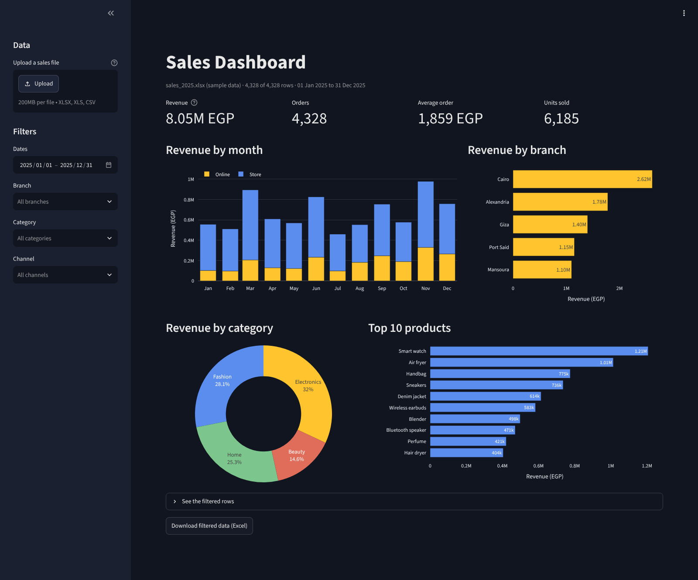
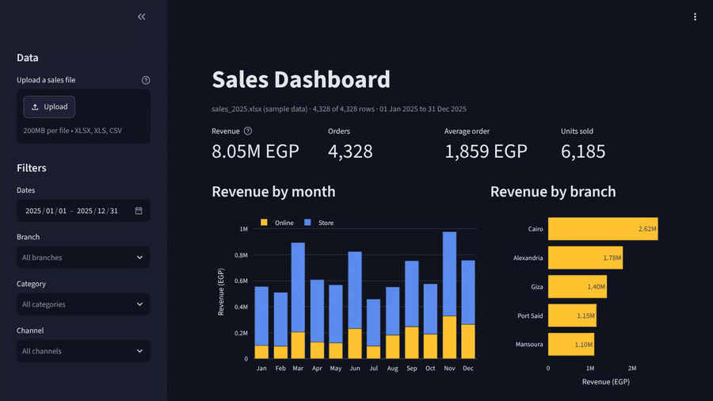

# Excel Sales Dashboard

[](../../actions/workflows/tests.yml)

Upload a sales export from Excel or CSV and get an interactive dashboard: revenue, orders and average order
value, monthly trend, branches, categories and top products, with filters and a comparison to the previous period.

**Live demo:** [mazen-sales-dashboard.streamlit.app](https://mazen-sales-dashboard.streamlit.app). It opens with the sample
data, and you can upload your own file. On the free plan the app sleeps when nobody has used it for a while, so the
first visit can take a few seconds to wake it up.



## The problem

Most small businesses already have their sales in Excel. Turning that into answers ("Which branch is
growing?", "Did White Friday beat last month?", "What sells best online?") usually means rebuilding the same
pivot tables and charts every month by hand.

## What it does

| Part | What you get |
|---|---|
| Upload | Any `.xlsx`, `.xls` or `.csv` export. Column names don't have to match: "Order Date", "Date" or "invoice_date" are all read as the date, "Total", "Amount" or "Sales" as revenue |
| Clean | Money typed as text (`EGP 1,200`) becomes numbers; dates in mixed formats are read day-first, ISO dates as written |
| KPIs | Revenue, orders, average order and units sold, each compared with the previous period of the same length |
| Charts | Revenue by month (store vs online), by branch, by category and the top 10 products |
| Filters | Date range, branch, category and channel; every number and chart updates |
| Export | Download the filtered rows as an Excel file |

Only a date and a revenue column are required. Branch, channel, category, product, quantity and order id unlock
the rest of the dashboard when they are in the file.

## Run it

```bash
pip install -r requirements.txt
python make_sample_sales.py      # creates data/sales_2025.xlsx (4,328 sample orders)
streamlit run app.py             # opens the dashboard in your browser
```

The sample data is loaded automatically. Upload your own file from the sidebar.



## What the sample data shows

The sample is a year of orders from a fictional retailer with five branches, sold in store and online
(`make_sample_sales.py`). The dashboard shows straight away:

- **8.05 million EGP** from 4,328 orders, an average order of **1,859 EGP**
- **Cairo** is the biggest branch (2.62M EGP), **Mansoura** the smallest (1.10M EGP)
- **November** (White Friday) is the best month and **July** the quietest
- Online grows from **18%** of revenue in January to **35%** in December

## Put your own copy online for free

The live demo runs on Streamlit Community Cloud. To host your own copy at a public link:

1. Sign in at [share.streamlit.io](https://share.streamlit.io) with GitHub.
2. Click **Create app**, pick this repository, branch `main` and the file `app.py`.
3. Click **Deploy**. The dashboard gets its own `.streamlit.app` link to share with clients.

## Tests

```bash
pytest
```

The tests check column detection on messy files, day-first and ISO dates, filters, the previous-period comparison
and the Excel download, and run the real app headlessly to check the KPIs and charts render and react to filters.

## Built with

Python · Streamlit · Plotly · pandas · openpyxl · pytest

## Need a dashboard for your own data?

I build dashboards like this for clients, from the Excel files they already use: sales, stock, expenses or
customers, with the numbers they care about and filters that make sense for their business. Send me a sample of
your data and tell me what you want to see.

<a href="https://www.upwork.com/freelancers/~01b6c711b0162ca691"></a>
<a href="mailto:mazen.elnaghy@gmail.com"></a>

Built by [Mazen Elnaghy](https://github.com/mazenelnaghy-code) · [Portfolio](https://mazenelnaghy-code.github.io)
